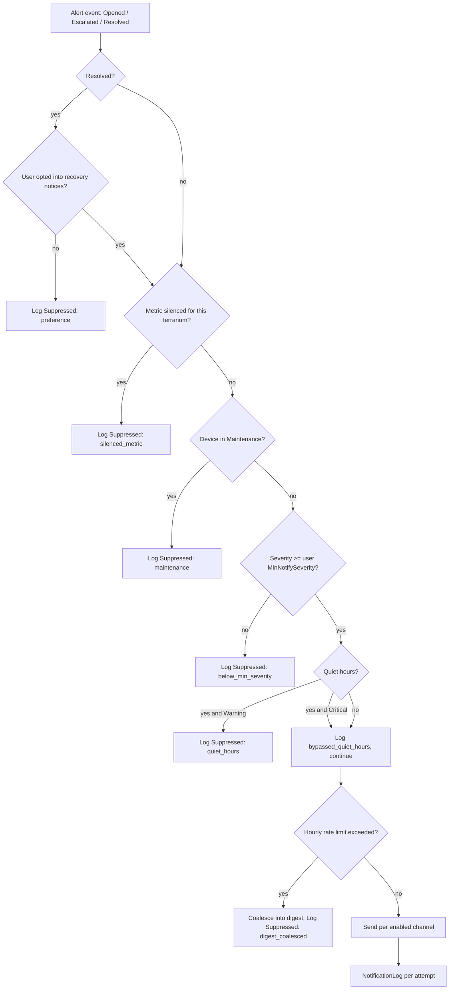

# 05 — Alerts and Notifications

## 1. Severity model

| Severity | Produced when | UX expectation | Notification policy |
|---|---|---|---|
| **Info** (reserved) | Device back online, buffer drained, calibration applied, export ready | Timeline entry only | In-app, never pushed |
| **Warning** | Value outside the target band for `dwellWarnMinutes` (default 5) | Card turns orange; banner on dashboard | Push if user's `MinNotifySeverity ≤ Warning` and quiet hours allow |
| **Critical** | Value outside the critical band for `dwellCritMinutes` (default 2), or `DeviceSilent` > 30 min | Card red; alert pinned; banner has action button | Push always; **bypasses quiet hours**; escalates if unacknowledged |

Rationale for only two operable severities: a third tier tempts the team into inventing distinctions the
biology does not support. `Info` exists only for system events.

## 2. Alert source matrix

**The two families (added 2026-10-17, role/permission and alert-family re-framing).** An excursion has two possible
subjects, and the product keeps them apart because they are read on different screens, answered by different actions
and judged against different bands:

| Family | Subject | Metrics | Judged against |
|---|---|---|---|
| **`enclosure`** | The enclosure itself and the board in it | `humidityPct`, `lightLux`, `batteryPct`, `rssiDbm` | The profile's humidity band, its photoperiod and light threshold, and the device's own health |
| **`species`** | The animal the enclosure holds | `tempC`, `uvIndex`, `surfaceTempC` | The species profile's thermal and UV bands — the reason the profile exists |

The split is a property of the **metric**, written once in `MetricDefinition.Family`
(`Domain/Metrics/MetricDictionary.cs`), so adding a metric is the only place the question is ever answered again. A
**device-level** alert — silence, a confirmed sensor fault, a clock skew — has no metric and is `enclosure`: the
board going quiet is a statement about the enclosure, not about the animal in it.

`Alert.Family` is **persisted** (migration `20261016162814_AddAlertFamily`, back-filled from the metric) rather than
derived on every read, for the same reason `BandMin`/`BandMax` are denormalised: a metric-less alert has nothing to
derive it from, and it is the column the lists filter and group by. It is published as `family` on every alert —
REST, and the `alertChanged` realtime payload — and `GET /alerts?family=enclosure|species` narrows a list to one of
them. An unknown key is refused rather than treated as "both", because a client that misspells it would otherwise
show one family's rows under the other family's heading.

**What the split changes in practice.** The alerts screen presents the two as separate views: the enclosure view is
the "what is wrong with the setup" question a keeper checks daily, and the species view is the "is my animal's
thermal environment right" question, which can only be asked when a species profile is in force. The administrator's
overview reports open counts for each family separately
(`07-appendices/03` §4.8 — the administrative dashboard), because a deployment whose enclosure alerts are mostly
board faults has a different problem from one whose species alerts are mostly temperature excursions. `GradientWarning` and `LightDeficit` below
land in `species` and `enclosure` respectively: the first compares two temperatures the animal feels, the second is
the lamp that lights the box.

Every source, with the family it lands in:

| Source | Trigger | Metric | Family | Typical false-positive cause | Mitigation built in |
|---|---|---|---|---|---|
| `Threshold` | Per-metric band violation (FR-11) | any measured | the metric's | Lamp repositioned, lid opened during cleaning, sensor in direct sun | Dwell + hysteresis + `Maintenance` device state + silence |
| `DeviceSilent` | No sample for `3 × interval` (Warning) / 30 min (Critical) | none | `enclosure` | Wi-Fi drop, power cut, someone unplugged the node | Buffer + auto-resolve on reconnect |
| `SensorFault` | Device reports ≥ 3 consecutive read failures | affected metric | the metric's | Wiring, condensation, dead sensor | Metric marked `Unavailable`, evaluation skipped — *not* alerted as a habitat problem |
| `DeviceClockSkew` | `\|ReceivedAt − RecordedAt\| > 120 s` | none | `enclosure` | NTP blocked, long power-off | Flag samples; fall back to server time for phase/day logic |
| `GradientWarning` *(SHOULD)* | `SurfaceTempC − TempC > 12 °C` | surface | `species` | Probe on the basking rock reads the lamp, not the rock | Documented placement rule (`07-appendices/04` §4) |
| `LightDeficit` *(SHOULD)* | Light-hours below profile minimum by 21:00 local | light | `enclosure` | Lamp/timer failure, cloudy season | Uses accumulated lux-hours, not instantaneous lux |

## 3. Notification channels

| Channel | Implementation | Auth/config | Failure handling | Notes |
|---|---|---|---|---|
| **In-app inbox** | `NotificationLog` rows rendered in S6 | user session | none needed | Always on; the audit trail of "what was sent" |
| **FCM push** | Firebase Admin SDK from `NotificationDispatcher` | service account JSON mounted read-only | 3 retries (5 s / 30 s / 2 min), token invalidation on `UNREGISTERED` | Android only in v1 |
| **SMTP email** | `System.Net.Mail` (optional) | SMTP credentials in `.env` | 3 retries, failures logged | Off by default; the out-of-band channel, useful for a "daily digest". The development stack runs **Mailpit** beside the API as the local sink (2026-10-16) |

Duplicate-channel control: if the same alert would be sent to both email and FCM within 30 s, both are
sent (different devices, different urgency), but the *digest* path collapses them.

## 4. Notification decision flow



`SuppressedReason` values (`quiet_hours`, `silenced_metric`, `maintenance`, `below_min_severity`,
`rate_limited`/`digest_coalesced`, `preference`, `no_channel`) exist so the report can show a real
suppression table instead of hand-waving about alert fatigue.

## 5. Rate limiting, digests and flapping

| Control | Value | Effect |
|---|---|---|
| Per-alert repeat | `cooldownMinutes` (default 60) for a still-open alert | An open alert re-notifies at most hourly, not every sample |
| Per-terrarium hourly cap | 10 notifications | The 11th+ becomes a digest entry; alerts are still created and visible in the inbox |
| Digest | Sent at the top of the next hour if anything was coalesced | One message: "7 warnings, 1 critical, worst 34.2 °C" |
| Flap suppression | Hysteresis 3 consecutive minutes inside by the recovery margin | Prevents open/resolve oscillation near the band |
| Silence window | ≤ 24 h, per metric, reason required, visible on the dashboard | Deliberate, accountable suppression |
| Maintenance mode | Device-level; notifies nobody but records everything | Cleaning/lamp changes without lying about data |

**Silences as built (2026-10-10, roadmap 3.4).** The write and read halves of this row exist:
`POST /terrariums/{id}/silences`, `GET` for the windows still in force and `DELETE` to cancel early, over the
`MetricSilence` table of `02-design/02` §3.15. The **decision** this table's flowchart makes — "metric silenced for
this terrarium?" → `Log Suppressed: silenced_metric` — stays with the dispatcher (3.5), which calls the same
`IsActiveAt`/`Covers` pair the list endpoint renders. Two readings the build settles: a window that names no metric
covers **every** metric of the terrarium *including its device-level alerts*, and a silence suppresses notification
only — the evaluator keeps raising, touching and resolving alerts during one, so the dashboard and the report show
exactly what was happening while the keeper was not being told.

**The dispatcher and the format as built (2026-10-16, roadmap 3.5).** The whole of §4's matrix, §5's cap and
digest, §6's ladder and BR-13.5's retries are built, and four readings of this document are now stated in the code
rather than here — the roadmap's 3.5 block records them in full. The three that change how this file is read:

- **The flowchart's "alert event" is a database sweep, not a subscription.** Four writers move an alert and they live
  in three layers, so the dispatcher asks the database "which alert could owe somebody a message?" every 15 seconds
  instead of being told. The answers are identical; the difference is that a lost pass re-derives the work rather
  than losing it, at the cost of the sweep interval's latency.
- **A suppression row carries the text that would have been sent.** §4's "Log Suppressed" entries are rendered
  before the decision is recorded, deliberately: a record that re-rendered its own text on read would describe the
  thresholds and the preferences of the day it is read rather than the day it happened.
- **The format is one `INotificationChannel` per channel and `ResourceManager` decks for the text**, so §8's promise
  ("the only non-deterministic part of the system is isolated to one seam") holds literally: the policy and the
  dispatcher are testable with no network, no database and no clock. `NotificationLog.Step` was added to the row for
  §6's timeline; see `07-appendices/02` §3.10.

## 6. Escalation

For **Critical** alerts only:

| Elapsed since open | Action |
|---|---|
| 0 min | Push to all users who enabled Critical |
| 30 min, unacknowledged | Repeat push; if a `Technician` exists and was not notified, notify them |
| 60 min, unacknowledged | Notify the `Owner` with an explicit "unacknowledged for 60 min" body |
| 120 min, unacknowledged | Email (out-of-band channel, likely read on a different device) + a permanent banner in the app |

Escalation stops at the first acknowledgement. Escalation events are logged as `NotificationLog` rows
with the same `AlertId`, so the report can show the full response timeline of one incident.

## 7. Notification content contract

Fields available to every channel (FR-13, BR-13.6):

```
title:  "{terrariumName} · {metricName} {direction}"     e.g. "Linh's gecko box · Temperature high"
body:   "{value}{unit} (band {targetMin}–{targetMax}{unit}), out of range {durationMin} min"
        "Critical band exceeded: > {criticalMax}{unit}"  (when critical)
deep:   smartreptile://alerts/{alertId}
```

Rules: no jargon ("dwell", "hysteresis" never appear in user-facing text), always include the band,
always include the duration, never include another user's data, and localise from the user's
`PreferredLanguage` — not stored per-language in the database (ADR-013).

## 8. Testability of the notification layer

Because channels are behind `INotificationChannel`, they are unit-testable with a fake:

```
TC-U-*: policy matrix tests — (severity, quietHours, minSeverity, silenced, maintenance, rateLimit)
        → expected SuppressedReason or Send. One test per cell of the matrix (12 cells).
TC-I-*: dispatcher integration with a fake FCM client and a local SMTP sink, asserting retry counts and logs.
TC-E2E-03: real FCM push received within 90 s of an induced excursion.
```

The *only* non-deterministic part of the system (a third-party push service) is therefore isolated to
one seam — which is also why the demo can fall back to the in-app inbox (and email) if FCM delivery is
flaky on the day.
