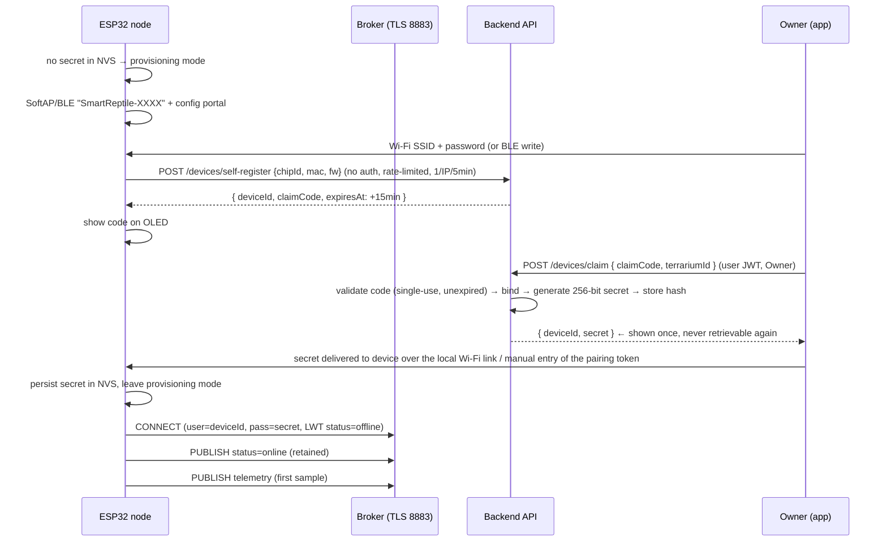

# 06 — Security, Device Auth and Provisioning

Scope: user authentication, device authentication, provisioning, authorisation, transport security,
secrets handling, and an honest threat model. Not in scope: physical tamper resistance, secure boot,
mTLS (both recorded as accepted limitations / v1.1 candidates).

## 1. Assets and the threats that matter for this project

| Asset | Why it matters | Primary threats | Control |
|---|---|---|---|
| Sensor readings | The product's value and the v2 dataset | Tampering, forged telemetry, deletion | Device auth, idempotency, append-only telemetry, audit log |
| Device secret | Grants write access to telemetry | Theft via flash read-out, replay, brute force | 256-bit random, hashed at rest, TLS-only, rotate/revoke |
| User credentials | Account takeover → all terrarium data | Credential stuffing, weak passwords, token theft | PBKDF2 (210 k) / Argon2id, throttling, short-lived JWT + rotating refresh |
| Terrarium & alert data | Privacy (who has an animal, home address implied) | Cross-tenant access, IDOR, enumeration | Owner-scoped queries, `404` on foreign ids, no enumerable endpoints |
| Threshold configurations | Correct alerts; false confidence if wrong | Silent tampering | Audit log with before/after; `ThresholdSnapshot` history |
| Notification channels | Spam/abuse vector, token leakage | Leaked FCM service account, SMTP credentials | Secrets only in `.env`/mounted files, never in repo or client, CI secret scan |
| Availability of the pipeline | Missed alerts | DoS on ingest, broker flood | Rate limits per device, bounded queues, `1883` disabled externally |

## 2. User authentication

| Aspect | Decision |
|---|---|
| Password storage | PBKDF2-HMAC-SHA256, ≥ 210 000 iterations, 16-byte random salt per user (or Argon2id m=64 MiB/t=3/p=1 if time allows). `PasswordIterations` is stored per user so the cost can be raised and rehashed on next login without a mass reset. |
| Password policy | ≥ 8 chars with ≥ 1 letter, ≥ 1 digit, ≥ 1 upper-case letter and ≥ 1 special character (a symbol that is not a letter or a digit — whitespace does not count), ≤ 128 chars; reject the top-1 000 common passwords (embedded list, no API call). Every rule carries its own violation code, so a form can name the rule that failed instead of saying only "refused". The composition rules are what the product brief asks for; the cap and the deny-list stay because they are what does the work. |
| Access token | JWT (HS256 in v1, RS256 if the API is split later), 15-minute lifetime, claims: `sub`, `role`, `iat`, `exp`, `jti`, `ver`. |
| Refresh token | Opaque 256-bit random, stored as SHA-256 hash, 30-day lifetime, **single-use with rotation**; reuse of a consumed token revokes the whole family (token-theft detection) and writes an audit entry. |
| Transport of tokens | App stores tokens in `flutter_secure_storage` (Android Keystore-backed), never in `shared_preferences`. |
| Throttling | 10 failed logins per username per 15 min → 15-min lock with an audit entry; 20 failures per IP per 15 min → 15-min block. Response time is constant-ish to avoid user enumeration by timing. |
| Error messages | Login failure is always the same generic message; registration on an existing email returns a neutral "if this address is free you will receive a confirmation" style response. |
| Session invalidation | Logout revokes the refresh token. A password change revokes every refresh token of the account **except the session that made the call**, which the request names by its refresh token (`ADR-022`): that caller has just re-proved the credential the change is about, so evicting them would be a sign-out with no security gain, while the sessions a keeper wants gone are the others. A caller that names no session — or names one this account does not hold — keeps none. |
| Password reset | Two anonymous paths, neither of which needs a mail server to be correct. **Backup recovery code:** registration returns a 20-character code drawn from the claim-code alphabet (31 symbols without `0/O/1/I/L`, ≈ 99 bits of entropy), stored as `SHA-256(code ‖ 16-byte salt)`; presenting it with a new password consumes it, issues a replacement and ends every session. **Server-issued code:** `POST /auth/forgot-password` issues a single-use, 30-minute code — stored unsalted so the row can be found by its SHA-256, like a refresh token — and hands it to a delivery channel (`IPasswordResetNotifier`); `POST /auth/reset-password` spends it. **Two answers are deliberately different from the rest (`ADR-020`):** registration reports a taken identifier (`409 registration_conflict`) and `forgot-password` reports an identifier nobody holds (`404 identifier_unknown`), because those are the two places where a non-disclosing answer costs the keeper more than it protects them. The reset and recovery paths stay non-disclosing — an unknown identifier, a spent code and another account's code are one failure — and the credential routes (login, registration, both reset paths and `change-password`) are throttled exactly like a login, while the session's own routes (`/auth/me`, `/auth/refresh`, `/auth/logout`) carry a separate, larger budget because a signed-in client calls them as housekeeping. Only delivery is unfinished: the demo has no mail server, so the code is written to the server log (`PasswordReset:LogCode`, development only) and limitation L-02 now covers the transport rather than the ability to reset. |

## 3. Roles and permissions

**Revised 2026-10-17: the matrix is data.** The three-member `UserRole` enum on `User.Role` is gone. A role is a row
in `Role`, a permission is a row in `Permission`, and the grant between them is a row in `RolePermission`. A
deployment can therefore re-band a role without a release, and an administrator's edit is a write an audit row
records. What stayed in code is the **catalogue** — the sixteen things the software can be asked to do, in
`Permissions.cs` — because a permission the software does not implement cannot be granted by inserting a row.

| Code | Group | What granting it allows (the caller's own account, unless marked) |
|---|---|---|
| `terrarium.read` | Enclosure | Read the caller's own enclosures, their bands and their readings. |
| `terrarium.write` | Enclosure | Create, edit and delete the caller's own enclosures, including per-enclosure threshold overrides. |
| `device.read` | Enclosure | Read the caller's own boards and their health. |
| `device.write` | Enclosure | Rename or remove a board the caller owns. |
| `device.provision` | Enclosure | Claim a board, pair one by MAC address, rotate its secret or revoke it. |
| `alert.read` | Alerts | Read the alerts of the caller's own enclosures, of **both families**. |
| `alert.write` | Alerts | Acknowledge and resolve alerts. |
| `silence.write` | Alerts | Open a time-boxed silence window and cancel one early. |
| `notification.read` | Alerts | Read the caller's own notification inbox. |
| `audit.read` | Account | Read the audit rows of the caller's own account and enclosures. |
| `species.read` | Catalogue | Read the shared species-profile catalogue. |
| `species.write` | Catalogue | Author the shared species-profile catalogue — the built-in bands every enclosure is judged against (FR-10). |
| `user.read` | Accounts | See accounts other than the caller's own. |
| `user.manage` | Accounts | Create an account, edit it, reset its password, disable, re-enable, change its role or delete it. |
| `data.read.any` | Whole system | **Cross-account:** read every account's enclosures, boards and alerts — the administrator's get-all dashboard. |
| `data.write.any` | Whole system | **Cross-account:** edit and delete any account's enclosure. |

### 3.1 Which data each role maps to

The four system roles ship with these grants. Their ids are fixed in `SystemRoles` (a deterministic id is what lets
registration assign `Owner` without a lookup that can fail on an unseeded database), and a migration writes them, so
a fresh deployment is complete before the application has run once.

| Role | Rank | Permissions | Reach |
|---|---|---|---|
| **Admin** | 0 | all sixteen | every account's data (`data.read.any`, `data.write.any`) plus the account and catalogue writes |
| **Owner** | 1 | 11 | the caller's own enclosures, boards, alerts, inbox and audit trail; species read-only |
| **Technician** | 2 | 7 | the caller's own enclosures and boards read-only, plus the alert and silence writes |
| **Viewer** | 3 | 5 | the caller's own data, read-only |

Read as a ladder, each step adds exactly what a reader would expect — Viewer → Technician adds the two alert writes,
Technician → Owner adds the enclosure and board writes plus the audit read, Owner → Admin adds the account
permissions, the catalogue write and the two cross-account ones. **Admin is therefore a superset of Owner by
construction**, which is what "Admin = toàn bộ dữ liệu" means as a fact about this seed rather than as a branch in a
service.

### 3.2 The scope decision: global, not membership

The matrix answers *what* a role may do. It does not answer *whose* data is returned — that is not a role question at
all:

- **Ownership is a column, not a table.** A terrarium belongs to the account in `Terrarium.UserId`, and every
  keeper-facing query is scoped to it in the store. There is deliberately no membership table: the product has one
  keeper per enclosure, so a table would exist to express a relationship that is already a column.
- **The cross-account case is a separate surface, not a flag on those queries.** `/api/v1/admin/*` is answered by a
  store (`EfAdminStore`) that has no owner parameter, so a keeper's scoped read cannot be widened by a mistake in a
  service. The only place a role widens a keeper-facing read is `TerrariumService.IsMemberAsync(..., mayReachAnyAccount)`,
  driven by `data.read.any`, which is why those two codes are marked *cross-account* in the catalogue and reported as
  `crossAccountPermissions` on every role.
- **Editing shared data is not the same right as editing one's own.** `species.write` is Admin-only: the catalogue is
  data every terrarium is judged against, so the keeper who may re-band their own enclosure may not rewrite the
  built-ins (BR-10.1, FR-10 A2). A keeper who needs bands the built-ins do not cover stays inside their own account
  with per-terrarium overrides (BR-10.3).

**Consequences for the two rows the earlier matrix drew differently.** Account management (`/users/*`) moved from
`Owner` to `user.manage`, so an administrator manages accounts and a keeper does not. `audit.read` stayed with the
account's own trail and is held by Owner and Admin; a Technician no longer reads it. `species.write` remains
Admin-only. Claim / rotate / revoke / rebind remain `device.provision`, which Owner holds and a Technician does not.

### 3.3 How the API enforces it

A **policy name is a permission code**. `AuthorizationPolicies.AddPermissionPolicies()` registers one policy per
catalogue entry and each endpoint names the code it needs, so a route never repeats a rule and a role name appears
nowhere in the API. A custom role created through the console authorises through the same policies with no code
change — which is the point of the table. `silence.write` is named by the two silence writes and by nothing else:
opening a silence is a decision about being told rather than about an alert's lifecycle, so a deployment that wants
an account which may acknowledge but not go quiet can say so with that one grant.
The API's OpenAPI descriptions name the same codes: a refusal there reads "Requires `terrarium.write`.", not
"Requires the Owner role."

The client side follows the same rule: `web/src` and `app/lib` gate screens on permission codes
(`hasPermission('terrarium.write')`), never on a role name, because the matrix is a deployment's decision and a
screen keyed on `Owner` would break the first time somebody re-banded a role.

**The token carries the answer.** The access token holds one `perm` claim per code plus `role` (for display only —
nothing authorises on it) and `ver` = `2`. `GET /auth/me` and the session body return `roleId` and `permissions`, so a
client can render its navigation without a second call.

**Session staleness is bounded and documented.** A role change, a password reset and a delete end the account's
refresh tokens, so the next refresh fails rather than silently keeping the old rights. An edit to the **matrix**
itself does *not* end sessions: accounts holding the role keep their tokens until they expire, so a revocation takes
effect within one access-token lifetime (15 minutes). The console warns about this rather than hiding it.

### 3.4 The guards, and the account that cannot be registered into existence

- **No self-change.** `409 self_change_refused` for any administrative action on the caller's own account, because an
  administrator who disables or demotes themselves is the one change nobody else may undo.
- **Never the last administrator.** `409 last_administrator_refused` when a change would leave nobody able to manage
  accounts. It is checked by *counting holders of `user.manage`* rather than by comparing role names, so a deployment
  that re-banded or split the administrator role is still protected — the same check runs before a role edit that
  would remove the permission from its last holder.
- **Deleting an account erases it, with what it held.** `DELETE /users/{id}` (2026-10-20) unbinds its boards,
  deletes its enclosures and everything cascading from them, deletes its own catalogue profiles and its inbox, and
  then the row — in one transaction. A board whose owner no longer exists is not left behind pointing at nothing: it
  is unbound and stays in the deployment for another account to claim. Disabling is the reversible act and the only
  way to keep the data.
- **Admin cannot be registered into existence.** `POST /auth/register` always produces an `Owner`. The one account
  that holds `Admin` is seeded at start-up from the `Admin` configuration section (`Admin:Username`, `Admin:Email`,
  `Admin:Password`, empty by default), which is also the credential's owner of record — editing `Admin:Password` and
  restarting rotates it. A deployment that configures no administrator has no account that can author the catalogue
  or manage accounts; promoting a second administrator through `/users` is how the last-admin guard is made
  survivable.

`IdentitySeeder` reconciles the catalogue and the four roles on every start-up, and it is deliberately asymmetric:
a **missing** row is created with its shipped grants, and an **existing** grant is never re-applied. An
administrator who removes `audit.read` from `Technician` has made a decision, and a start-up that re-applied the
defaults would silently undo it. A new permission appears in the console and is granted to nobody, because widening
a role's reach is not a decision a start-up may take.

**The terrarium routes now answer three ways instead of one (2026-10-14, TASKS item 3).** A missing terrarium is
`404 not_found`, one belonging to another account is `403 forbidden_terrarium`, and a soft-deleted one is
`410 terrarium_deleted`. BR-02.2's uniform `404` exists to stop ids being probed, and the review's position is that a
keeper who mistyped an id and a keeper looking at somebody else's enclosure need different next steps — the trade is
accepted for **this resource only**, and recorded in `05-release/03` §5 so nobody assumes the other resources agree.
Alerts, silences, species profiles and devices keep the uniform `404`. The realtime hub keeps it too, deliberately:
a socket that names ids would otherwise become the probing surface the REST routes no longer are.

## 4. Device authentication

### 4.1 Credential model

| Property | Value |
|---|---|
| Secret | 256-bit CSPRNG, base32-encoded (52 chars), issued once at claim time |
| Storage server-side | `SHA-256(secret ‖ 16-byte salt)`, constant-time comparison (`CryptographicOperations.FixedTimeEquals`) |
| Storage device-side | ESP32 NVS (encrypted NVS is enabled where the partition layout allows; not claimed as tamper-proof) |
| MQTT use | `username = deviceId`, `password = secret` |
| HTTPS fallback use | `Authorization: Device {deviceId}.{secret}` |
| Rotation | New secret issued; old one valid for a 10-minute grace window (`GraceUntil`) so the device can reconnect and persist it |
| Revocation | `RevokedAt` set → subscriber kicks the MQTT session, API rejects the credential, audit entry written |

### 4.2 Why not certificates in v1

mTLS with per-device certificates would be stronger, but it requires a CA, per-device provisioning of
keys/certs on an ESP32 without a secure element, and certificate lifecycle tooling — cost that does not
buy meaningful protection for a hobby device whose flash can be read out anyway. Recorded as ADR-006
with the **v1.1 path**: ESP32 `esp_secure_cert`/`esp-tls` with a per-device client certificate, or a
secure element (ATECC608A) for key storage.

## 5. Provisioning flow (UC-01 in detail)

**Decided `[TBC-4]` → `ADR-016`:** how the secret reaches the device in step 10. Option A is the design; option B
survives only as the demo-day fallback. Two options were considered:

| Option | Mechanism | Trade-off |
|---|---|---|
| A (default) | The app sends the secret to the device over the local network with an **8-digit pairing token** that the device displays (the same channel used for Wi-Fi config), one-time use, 5-min TTL, HTTPS with the device's self-signed cert pinned by fingerprint | Good UX, small attack surface, extra firmware endpoint |
| B (fallback) | The user types the secret into the captive portal (long base32 string) | No extra endpoint, terrible UX |

Option A is decided (`ADR-016`); option B remains the demo-day fallback if the pairing endpoint is not finished in
time. Either way the secret is returned exactly once and stored hashed (ADR-006, BR-05.3).

**Anti-abuse on `self-register`:** unauthenticated by necessity, so it is rate-limited (1 request per IP
per 5 min, 20 per hour globally for the demo), payload-validated, and creates devices in
`Provisioning` state with zero capability. Unclaimed devices older than 24 h are swept. A flood can
create junk rows but can never read or write other tenants' data.

**Claim-code properties:** 8 chars from a 31-symbol alphabet excluding `0/O/1/I/L` (see
`07-appendices/03` §2.1), 15-minute TTL, regenerated while in provisioning mode, single-use, and —
crucially — **the same error is returned for unknown, expired and consumed codes** (BR-04.3).

**The lower-trust pairing path (built 2026-10-14, TASKS item 8): `POST /devices/claim-by-mac`.** A claim code proves
the caller has the board in front of them; a MAC proves nothing — it is printed on the case, broadcast on every
network the board joins, and guessable in bulk. The route exists because a keeper holding a board whose screen has
failed should not be stuck, and it is constrained so the weakness stays bounded:

| Aspect | Decision |
|---|---|
| Who may use it | `Owner` only — the same role the code path requires, so it is an alternative to reading a screen rather than a way around authentication |
| Which boards | Only one that has already self-registered (chip id and MAC on file, no secret issued yet) **and** is unbound and unrevoked (`DeviceProvisioningRules.IsClaimableByMac`) |
| Matching | The address is normalised — `AA:BB:CC:DD:EE:FF`, `aa-bb-…`, `AABB.CCDD.EEFF` and bare hex all name one board — and compared case-insensitively against the stored colon form, which self-registration's own validator guarantees |
| Failures | One `404 device_not_found` for unknown, already bound and revoked alike, so the route cannot be used to test whether an address belongs to this fleet |
| Evidence | The audit row is `device.claimed` with `"method":"mac_address"`; the code path writes `"method":"claim_code"`, so the trail says how each board was bound |
| Default | Unchanged: the code path remains the documented flow, and the route description says in as many words that this one is lower-trust |

**Binding a board while creating its enclosure (built 2026-10-14, TASKS item 2).** `POST /terrariums` accepts
`deviceId` or `macAddress`, and that path goes through the same rules and the same staging step as the two claim
routes: one implementation of "what a binding is", reached from three entry points. It differs in one respect — the
enclosure being created and the binding commit in **one unit of work**, so a failure between them cannot leave either
an enclosure whose board nobody can use or a board pointing at an enclosure that was never written. The secret is
returned once on that response, because binding without a credential would leave a board that can neither publish nor
be claimed again.

## 6. Transport and platform security

| Item | v1 decision |
|---|---|
| MQTT | TLS 1.2+ on `8883` only; `1883` bound to loopback for local debugging and *disabled* in the release runbook; broker requires credentials (`allow_anonymous false`) |
| HTTPS | TLS 1.2+; HSTS on the dashboard host; HTTP redirects to HTTPS |
| Certificates | Let's Encrypt hostname in the runbook; self-signed/internal CA acceptable only for the local demo, and the ESP32 is flashed with the matching CA bundle |
| Firmware | WiFi credentials stored in NVS; OTA disabled (no attack surface for unsigned updates); debug serial logs must not print the secret |
| API input handling | Model validation + explicit allow-lists; no raw SQL (EF Core parameterised only); file uploads (snapshots) limited to 512 KB, content-type checked, `sha256` recorded, filename never used for the storage path |
| Rate limits | auth 10/min/IP · ingest HTTP 6/min/device · snapshot 1/30 s/device · exports 5/hour/user · self-register 1/5min/IP |
| Headers | Dashboard served with `X-Content-Type-Options: nosniff`, `X-Frame-Options: DENY`, `Referrer-Policy: no-referrer`, CSP without `unsafe-inline` |
| Dependencies | `dotnet list package --vulnerable` in CI; `flutter pub outdated` review each milestone (NFR-08) |
| Secrets | `.env` (git-ignored) + mounted files; CI runs a secret scan; `appsettings.*.json` contain no secrets |
| Backups | SQL Server backup file created before the demo, stored off the host (protects against a demo-day DB accident, not against a determined attacker) |

## 7. OWASP IoT Top 10 review (2018 list, checked item by item)

| # | Risk | Status in v1 | Note |
|---|---|---|---|
| I1 | Weak, guessable, or hardcoded passwords | ✅ Mitigated | 256-bit per-device random secrets; no default password; no secret in firmware source |
| I2 | Insecure network services | ✅ Mitigated | Only MQTT/TLS + HTTPS exposed; no telnet/HTTP debug service in release firmware; `1883` loopback-only |
| I3 | Insecure ecosystem interfaces | ⚠ Partly | API + app reviewed; the **captive portal** during provisioning is the weak spot — mitigated by a 5-minute window and no persistent credential issuance without the claim step |
| I4 | Lack of secure update mechanism | ⚠ Accepted | No OTA in v1 → no update attack surface, but also no way to patch a deployed device. Accepted for a monitoring-only prototype (limit L-03) |
| I5 | Use of insecure or outdated components | ✅ Managed | Pinned versions, vulnerability scan in CI, no abandoned libraries (no `DHT` sensor libraries; SHT31/BH1750/LTR390 all active) |
| I6 | Insufficient privacy protection | ✅ Mitigated | Owner-scoped data, no third-party analytics, camera off by default with a 7-day retention and a consent note |
| I7 | Insecure data transfer and storage | ✅ Mitigated | TLS everywhere; passwords and secrets hashed; DB reachable only inside the Compose network |
| I8 | Lack of device management | ✅ Mitigated | Fleet view, revoke, rotate, last-seen, firmware version, audit log |
| I9 | Insecure default settings | ✅ Mitigated | Anonymous MQTT off, no default admin account, `Development`-only auto-migrations, CORS allow-list |
| I10 | Lack of physical hardening | ❌ Not addressed | Flash read-out gives the device secret; no secure element. Declared as limitation L-01, and the design limits the blast radius (a stolen device can only publish to *its own* terrarium, and can be revoked) |

Being explicit about I3, I4 and I10 is deliberate: a report that claims ten green ticks invites a
question the team cannot answer.

## 8. Privacy notes

- The system stores no personal data beyond username/email and an optional terrarium location string.
  Users are advised in the settings screen not to enter an address, only a room label.
- Camera snapshots could show a home interior; the feature is off by default, has a 7-day retention, and
  is excluded from the v2 dataset by default (BR-17.3).
- Account deletion removes user rows, their terrariums, raw telemetry, rollups, summaries, snapshots and
  export files; alerts and audit rows are anonymised (`UserId` set to null) rather than deleted, so the
  dataset remains coherent for research use without identifying anyone. This behaviour is stated in the
  settings screen before deletion.

## 9. Security verification checklist (evidence for the report)

| Check | Method | Expected result |
|---|---|---|
| Anonymous MQTT publish rejected | `mosquitto_pub` without credentials | Connection refused |
| Wrong device secret rejected + audited | publish with a bad password | Refused, `auth_failed` audit row, `ingest_rejected_total` increments |
| Cross-tenant read blocked | request another user's terrarium with a valid token | `404` |
| Viewer cannot mutate | `POST /alerts/{id}/ack` with a Viewer token | `403 insufficient_role` |
| Expired/consumed claim code rejected identically | submit each case | Same body and status (`404 claim_code_invalid`) |
| Revoked device blocked within 60 s | revoke, then publish | Not persisted; status `revoked` |
| Secret rotation grace window works | rotate, reconnect with old secret within 10 min | Connects, audit warning written |
| Refreshed-token reuse detected | use a consumed refresh token | Family revoked, audit entry |
| Password throttle | 11 failed logins | Lock + audit; no user enumeration in the response |
| No secrets in the repo | `git grep` for token/secret patterns + CI scan | No matches |
| TLS enforced | connect to `1883` from another host | Refused |
| Rate limits | burst beyond limits | `429` with `Retry-After` |
