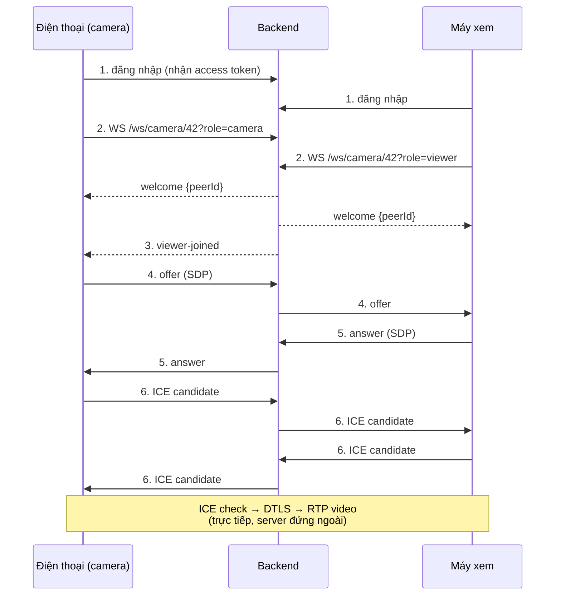

# 09 — Camera trực tiếp: cơ chế kết nối

Tài liệu này giải thích **vì sao camera demo lúc chạy được lúc không**, bằng ngôn ngữ dễ hiểu. Đọc xong bạn
tự chẩn đoán được sự cố chỉ với `adb logcat`.

## 1. Có hai đường khác nhau, đừng lẫn

```
                    ┌──────────────────────────┐
                    │  Backend (PC :8080)      │
                    │  WebSocket /ws/camera/…  │
                    └───────┬──────────┬───────┘
       ① tín hiệu (vài KB)  │          │  ① tín hiệu (vài KB)
                     ┌──────▼─────┐ ┌──▼─────────┐
                     │ ĐIỆN THOẠI │ │  EMULATOR  │
                     │ (máy phát) │ │  (máy xem) │
                     └──────┬─────┘ └─────┬──────┘
                            │             │
                            └──② HÌNH ẢNH─┘
                            P2P — KHÔNG qua server
```

| Đường | Đi qua đâu | Chở gì |
|---|---|---|
| ① **Kênh tín hiệu** | WebSocket lên backend `/ws/camera/{terrariumId}` | "Tôi có mặt", SDP offer/answer, địa chỉ mạng (ICE). Chỉ vài KB, **không có video** |
| ② **Đường video** | **Trực tiếp giữa hai máy** (peer-to-peer) | H.264 1280×720 ≈ 2.5 Mbps |

Server chỉ là **bà mối giới thiệu**, không nhận và không lưu video. Nhờ vậy app vẫn chạy khi tắt web, nhưng cũng
vì vậy mà **"giới thiệu được hay không" phụ thuộc hoàn toàn vào mạng của hai máy**.

## 2. Trình tự bắt tay



Chỉ **bên phát tạo offer** — vì chỉ nó biết mình có track gì; bên xem trả lời. Bước 1–2 đi qua cáp/hotspot/Wi-Fi
đều được, miễn tới được API.

## 3. ICE — mỗi bên tự khai "địa chỉ nào gọi tới tôi được"

Mỗi máy liệt kê mọi địa chỉ có thể liên lạc, gửi cho đối phương, rồi hai bên **gõ cửa thử** (STUN binding
request). Cặp nào gõ được và có trả lời thì lấy cặp đó.

| Loại candidate | Nghĩa | Ví dụ (đã che số) |
|---|---|---|
| **host** | IP thật trên card mạng của máy | `host:udp:192.168.1.50` (Wi-Fi), `host:udp:7.x.x.x` (4G), `host:udp:10.0.2.15` (emulator) |
| **srflx** | IP **công cộng** mà STUN nhìn thấy (phải hỏi `stun.l.google.com`) | `srflx:udp:27.x.x.x:23817` — IP nhà mạng của điện thoại |
| **relay** | IP trên **server TURN**; luôn đi được nhưng video phải chạy qua server đó | `relay:udp:<ip-turn>:port` |

Kết quả ICE:

- `checking → connected` ⇒ có cặp dùng được, video chạy.
- `checking → failed` ⇒ gõ hết các cửa mà không ai trả lời ⇒ **mạng không có đường nào đi được**.

## 4. Vì sao **cùng một Wi-Fi thì luôn chạy**

```
Điện thoại 192.168.1.50  ──── cùng LAN ────  PC 192.168.1.171  (emulator nằm sau NAT của qemu)
```
Hai máy nhìn thấy nhau ngay ở **host candidate** — gói tin đi thẳng trong LAN, không cần STUN, không cần TURN.

## 5. Vì sao **4G + phát hotspot** thì không chạy

Có hai rào cản cộng lại, gỡ một cái vẫn hỏng:

**(a) Điện thoại chỉ bắn ICE ra interface 4G.** WebRTC trên Android chỉ dùng network mặc định. Log cho thấy nó
**nhận** được gói của máy xem (nên biết địa chỉ `10.182.93.x`), nhưng gói trả lời lại đi ra từ IP 4G
(`7.x.x.x`) nên rơi vào hư không:

```
Conn[... Net[ccmni2:7.0.0.x/8:Cellular] ... host:udp:7.x.x.x:47039
     -> prflx:udp:10.182.93.x:56438]  Sent STUN BINDING request
```

**(b) Emulator nằm sau NAT của qemu** (`10.0.2.15`). Nó gọi **ra** được, nhưng không ai gọi **vào** được. Muốn
nối thì gói phải "hairpin" qua NAT của nhà mạng (từ `27.x.x.x` quay lại chính `27.x.x.x`) — các nhà mạng
thường chặn.

Thêm nữa, nếu DNS của emulator hỏng thì nó còn không lấy được srflx:

```
W/stun_port.cc: StunPort: stun host lookup received error 7
```

## 6. TURN — trạm trung chuyển, chỉ dùng khi P2P bó tay

```
   Điện thoại ──────►  TURN server (IP công cộng)  ◄────── Emulator
              cả hai đều CHỦ ĐỘNG gọi ra, không ai cần gọi vào ai
```

Vì cả hai đều gọi **ra** một IP công cộng nên NAT, 4G, qemu đều không còn là vấn đề. Đổi lại: video **đi qua
server của bạn** → tốn băng thông và tăng độ trễ ~10–50 ms.

Bật bằng ba `dart-define`, cấu hình gom một chỗ ở `lib/services/ice_servers.dart` để hai vai không lệch nhau:

```
--dart-define=TURN_URL=turn:<ip>:3478 \
--dart-define=TURN_USERNAME=<user> \
--dart-define=TURN_PASSWORD=<pass>
```

## 7. Khi nào chạy được

| Kịch bản | P2P trực tiếp | Cần TURN | Kết quả |
|---|---|---|---|
| Điện thoại + PC **cùng một Wi-Fi**, emulator làm máy xem | ✅ host candidate | Không | ✅ |
| 2 điện thoại nối chung 1 router / 1 hotspot | ✅ | Không | ✅ |
| Điện thoại 4G + hotspot cho PC + emulator xem | ❌ | ✅ TURN **trên internet** (VPS) | ✅ nếu có VPS |
| Điện thoại 4G + hotspot + TURN chạy **trên PC** | ❌ điện thoại không tới được IP hotspot | — | ❌ |
| Hai máy ở hai mạng khác nhau | ❌ | ✅ | ✅ nếu có TURN |

## 8. Đọc log để tự chẩn đoán

```bash
adb logcat --pid=$(adb shell pidof com.smartreptile.smart_reptile) | grep -E 'connection.cc|peer_connection|stun_port'
```

| Dòng log | Nghĩa |
|---|---|
| `... host:udp:X -> srflx:udp:Y] Sent STUN BINDING request` | đang gõ cửa địa chỉ Y — xem có trả lời không |
| `Changing standardized IceConnectionState checking => failed` | gõ hết mà không ai mở cửa ⇒ mạng không có cặp dùng được |
| `StunPort: stun host lookup received error 7` | không phân giải được `stun.l.google.com` ⇒ không có IP công cộng |
| `Port[relay:...] encountered error while gathering candidates` | không kết nối được server TURN đã khai báo |
| `onConnectionChange CONNECTED` + có hình | xong |

## 9. Vị trí code

| Thành phần | File |
|---|---|
| Kênh tín hiệu WebSocket (client) | `app/lib/services/camera_signaling.dart` |
| Cấu hình ICE dùng chung | `app/lib/services/ice_servers.dart` |
| Bên phát: getUserMedia, offer, wakelock | `app/lib/screens/camera_publisher_screen.dart` |
| Bên xem: answer, gắn track, watchdog | `app/lib/widgets/webrtc_camera_view.dart` |
| Server: ghép phòng camera, chuyển tiếp offer/answer/ICE | `backend/src/SmartReptile.Api/Endpoints/CameraEndpoints.cs`, `backend/src/SmartReptile.Application/Camera/CameraRoomRegistry.cs` |

## 10. Checklist trước khi demo

1. Backend `http://localhost:8080/health/ready` = `Healthy`.
2. `adb devices` thấy **cả** điện thoại và emulator.
3. `adb reverse tcp:8080 tcp:8080` cho từng máy (script `setup-mobile.ps1` làm sẵn).
4. **Hai máy cùng một mạng LAN** (kiểm tra bằng `ipconfig` của PC và IP của điện thoại).
5. Điện thoại: mở app → Terrarium → "Camera trực tiếp" → **Bật camera**, giữ app ở foreground (MIUI dễ kill
   app ở nền — xem mục 12 trong `app/README.md`).
6. Emulator: vào cùng bể, tab WebRTC; badge chuyển `ĐANG KẾT NỐI` → `TRỰC TIẾP`.

Nếu bước 6 báo `Không thiết lập được đường truyền video`: đọc mục 8, gần như chắc chắn là rơi vào một trong
các dòng ở bảng mục 7.
